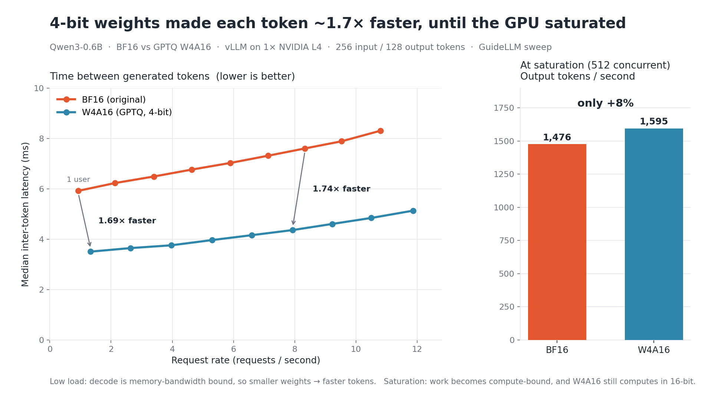

# Quantizing Qwen3-0.6B with GPTQ (W4A16) and serving it with vLLM

**What does 4-bit quantization actually change when you serve an LLM?**
This repo quantizes Qwen3-0.6B with GPTQ (W4A16), then compares it against the original BF16 model on three things: model size, accuracy, and serving performance under load with vLLM.

A small model was chosen on purpose. The goal was to run the full pipeline cheaply (quantize → evaluate → serve → load-test) and observe each trade-off directly, not to build a production model.

📝 **Full write-up:** [LinkedIn article](https://www.linkedin.com/pulse/training-one-time-bill-serving-forever-what-4-bit-actually-ganatra-oyjgf/)



---

## Results at a glance

| | BF16 (original) | W4A16 (GPTQ) | Change |
|---|---|---|---|
| Model size on disk | 1.1 GB | 524 MB | **~52% smaller** |
| Inter-token latency, 1 user | 5.92 ms | 3.51 ms | **1.69× faster** |
| Inter-token latency, ~8 req/s | 7.60 ms | 4.36 ms | **1.74× faster** |
| Output throughput at saturation (512 concurrent) | 1,476 tok/s | 1,595 tok/s | **+8%** |
| ARC-Easy (acc) | 60.7 | 55.1 | −5.6 |
| HellaSwag (acc_norm) | 47.5 | 45.8 | −1.7 |

**Key takeaways**

- **Size reduction is ~52%, not 75%.** About 26% of Qwen3-0.6B's parameters sit in the 151,936 × 1024 embedding table (shared with the output layer), which stays in BF16.
- **The speedup is a memory-bandwidth effect.** At low to moderate load, decoding is limited by how fast weights are read from GPU memory. 4-bit weights cut that traffic, so each token is ~1.7× faster. At saturation, the work becomes compute-bound, and since W4A16 still computes in 16-bit, the gain shrinks to ~8%.
- **Small models pay a larger accuracy penalty.** This matches published findings that 4-bit quantization hurts small models much more than large ones.

---

## Setup

| Component | Details |
|---|---|
| Model | Qwen3-0.6B (BF16) |
| Quantization | GPTQ, W4A16 (4-bit weights, 16-bit activations), via `llm-compressor` |
| Calibration data | 256 samples from `HuggingFaceH4/ultrachat_200k` (`train_sft`), max sequence length 4096 |
| Layers kept in BF16 | `lm_head` (tied to the embedding table) |
| Quantization hardware | MacBook Air M3 (MPS backend), ~8.5 hours |
| Serving | vLLM, `--gpu-memory-utilization 0.8` |
| Serving hardware | 1× NVIDIA L4 (24 GB) |
| Load testing | GuideLLM 0.8.1, sweep profile, synthetic prompts (256 input / 128 output tokens), 30 s per step, up to 512 concurrent requests |
| Accuracy eval | lm-evaluation-harness, `arc_easy` and `hellaswag`, 1,000 samples per task |

---

## Repository structure

```
.
├── README.md
├── notebooks/
│   └── gptq_quantization.html        # quantization + evaluation notebook (exported)
├── benchmarks/
│   ├── benchmarks_bf16.json          # GuideLLM results, BF16 model
│   ├── benchmarks_bf16.csv
│   ├── benchmarks_quantized.json     # GuideLLM results, W4A16 model
│   └── benchmarks_quantized.csv
└── images/
    └── itl_vs_request_rate.png
```

> The server address in the benchmark files has been replaced with `VLLM_SERVER_HOST`.

---

## How to reproduce

### 1. Install dependencies

```bash
pip install transformers datasets llmcompressor lm-eval vllm "guidellm==0.8.1"
```

### 2. Quantize with GPTQ (W4A16)

```python
from transformers import AutoModelForCausalLM, AutoTokenizer
from datasets import load_dataset
from llmcompressor import oneshot
from llmcompressor.modifiers.quantization import GPTQModifier

model_path = "./qwen-3-0-6b"
tokenizer = AutoTokenizer.from_pretrained(model_path, trust_remote_code=True)
model = AutoModelForCausalLM.from_pretrained(
    model_path, device_map="auto", dtype="bfloat16", trust_remote_code=True
)

# Calibration data
ds = load_dataset("HuggingFaceH4/ultrachat_200k")["train_sft"].select(range(512))

def preprocess(example):
    return {"text": tokenizer.apply_chat_template(example["messages"], tokenize=False)}

def tokenize(sample):
    # add_special_tokens=False because the chat template already adds them
    return tokenizer(sample["text"], padding=False, max_length=4096,
                     truncation=True, add_special_tokens=False)

ds = ds.map(preprocess)
ds = ds.map(tokenize, remove_columns=ds.column_names)

# GPTQ W4A16, keep lm_head in BF16
recipe = GPTQModifier(targets="Linear", scheme="W4A16", ignore=["lm_head"])

oneshot(
    model=model,
    dataset=ds,
    recipe=recipe,
    max_seq_length=4096,
    num_calibration_samples=256,
    output_dir="./qwen-3-0-6b-compressed",
)
```

### 3. Evaluate accuracy

```python
import lm_eval

MODELS = {"bf16": "./qwen-3-0-6b", "w4a16": "./qwen-3-0-6b-compressed"}

for name, path in MODELS.items():
    out = lm_eval.simple_evaluate(
        model="hf",
        model_args=f"pretrained={path},dtype=bfloat16",
        tasks=["arc_easy", "hellaswag"],
        limit=1000,
        batch_size=8,
        device="mps",   # use "cuda" on an NVIDIA GPU
    )
    print(f"\n=== {name} ===")
    for task, r in out["results"].items():
        print(task, {k: round(v, 3) for k, v in r.items() if isinstance(v, float)})
```

### 4. Serve with vLLM

Run one model at a time with the same settings:

```bash
vllm serve ./qwen-3-0-6b             --trust-remote-code --gpu-memory-utilization 0.8
vllm serve ./qwen-3-0-6b-compressed  --trust-remote-code --gpu-memory-utilization 0.8
```

### 5. Load test with GuideLLM

Configuration used (GuideLLM 0.8.1):

- Backend: OpenAI-compatible HTTP, `/v1/chat/completions`, streaming
- Profile: `sweep` (synchronous → 10 constant-rate steps → max throughput), max concurrency 512
- Data: synthetic text, 256 prompt tokens, 128 output tokens
- Duration: 30 seconds per step

```bash
guidellm benchmark \
  --target http://VLLM_SERVER_HOST:8000 \
  --profile sweep \
  --max-seconds 30 \
  --data "prompt_tokens=256,output_tokens=128" \
  --processor ./qwen-3-0-6b-compressed \
  --output-path benchmarks_quantized.json
```

> Flag names can differ between GuideLLM versions. Run `guidellm benchmark --help` to check yours.

---

## Detailed results

### Accuracy (1,000 samples per task, standard error ≈ ±1.5 points)

| Benchmark | BF16 | W4A16 | Change |
|---|---|---|---|
| ARC-Easy (acc) | 60.7 | 55.1 | −5.6 |
| ARC-Easy (acc_norm) | 57.0 | 53.3 | −3.7 |
| HellaSwag (acc) | 38.2 | 36.6 | −1.6 |
| HellaSwag (acc_norm) | 47.5 | 45.8 | −1.7 |

### Serving performance (vLLM, 1× NVIDIA L4)

| Load | BF16 ITL | W4A16 ITL | Speedup | BF16 latency | W4A16 latency |
|---|---|---|---|---|---|
| 1 user (synchronous) | 5.92 ms | 3.51 ms | 1.69× | 0.91 s | 0.60 s |
| ~2.5 req/s | 6.23 ms | 3.65 ms | 1.71× | 0.95 s | 0.62 s |
| ~5 req/s | 6.76 ms | 3.97 ms | 1.70× | 1.02 s | 0.66 s |
| ~8 req/s | 7.60 ms | 4.36 ms | 1.74× | 1.13 s | 0.71 s |
| ~10.5 req/s | 8.30 ms | 4.84 ms | 1.71× | 1.23 s | 0.78 s |
| Saturation (512 concurrent) | 1,476 tok/s | 1,595 tok/s | +8% throughput | | |

*ITL = median inter-token latency. Latency = median end-to-end request latency. Constant-rate steps don't line up exactly because GuideLLM picks sweep points from each model's own measured capacity.*

### Size breakdown

| Component | Parameters | Format | Approx. size |
|---|---|---|---|
| Decoder linear layers (28 layers) | ~440M | INT4 | ~220 MB |
| Group-wise scales (1 per 128 weights) | — | BF16 | ~7 MB |
| Embedding table (shared with `lm_head`) | ~156M | BF16 | ~311 MB |
| **Total** | **~596M** | | **~538 MB (≈513 MiB)** |

The predicted size is within ~2% of the measured 524 MB.

---

## Limitations

- One model, one GPU, one run per configuration.
- 1,000 evaluation samples per task.
- Synthetic prompts of fixed length with no shared prefixes, so vLLM's prefix caching was not exercised.
- Client and server were on different networks, so time to first token (~150 ms for both models) is likely dominated by network latency.

---

## References

- Frantar et al., [GPTQ: Accurate Post-Training Quantization for Generative Pre-trained Transformers](https://arxiv.org/abs/2210.17323)
- Kwon et al., [Efficient Memory Management for Large Language Model Serving with PagedAttention](https://arxiv.org/abs/2309.06180) (vLLM)
- Frantar et al., [MARLIN: Mixed-Precision Auto-Regressive Parallel Inference on Large Language Models](https://arxiv.org/abs/2408.11743)
- Zheng et al., [An Empirical Study of Qwen3 Quantization](https://arxiv.org/abs/2505.02214)
- [llm-compressor](https://github.com/vllm-project/llm-compressor) · [vLLM](https://github.com/vllm-project/vllm) · [GuideLLM](https://github.com/vllm-project/guidellm) · [lm-evaluation-harness](https://github.com/EleutherAI/lm-evaluation-harness)
